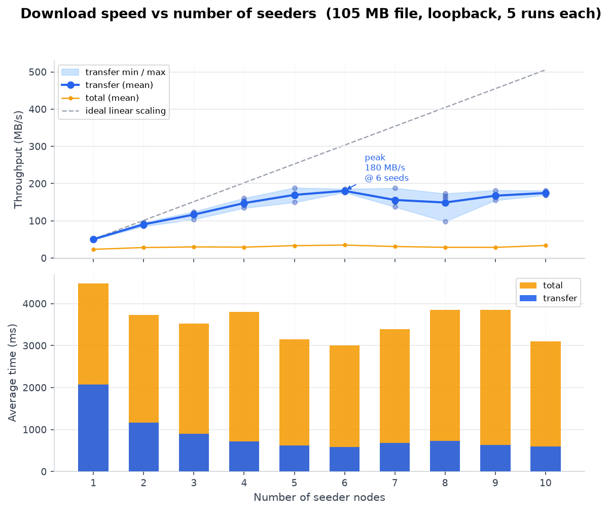

# PeerBlocks

[](https://github.com/JoaoReis153/PeerBlocks/actions/workflows/ci.yml)

A peer-to-peer file-sharing app in Java. Nodes search each other's files by name, then download a file in blocks from every peer that has it, with no central server.

## How it works

1. Each node listens on port `8080 + id` and shares the files in its folder, `nodes/node-<id>/`.
2. You connect nodes to each other, then search a keyword. Every connected peer replies with its files whose name contains it.
3. Files are identified by their SHA-256 hash, so the same file on several peers is downloaded from all of them at once.
4. The file is split into blocks of up to 1 MB. The downloader keeps a few block requests waiting at each peer, so faster peers end up sending more blocks.
5. If a peer drops or stops answering, its blocks go to the other peers.
6. Blocks are written to a hidden `.part` file. When all have arrived, the hash is checked and the file is saved. A name that's already taken gets a number, as in `name (1).ext`.

## Requirements

- Java 21
- Nothing else: the Gradle wrapper is included.

## Running

Start a node. It asks for an id and opens a window:

```bash
./gradlew run
```

Start a second node in another terminal with a different id, then use **Connect to Node** to link them. The other node asks to accept the connection. To share files, put them in `nodes/node-<id>/` while the node runs. The folder is emptied when the node starts and deleted when it closes.

To open several connected nodes at once:

```bash
./gradlew demo --args="1 2 3"
```

Without ids it opens nodes 1, 2 and 3. The first node shares three generated sample files, so search in another window and download them.

## Tests

```bash
./gradlew build
```

This compiles the code, checks formatting (Spotless), and runs the tests. CI runs the same command on every push. To fix formatting:

```bash
./gradlew spotlessApply
```

## Benchmark

Measures download speed with 1 to N seeders. A seeder is a peer that has the whole file. All nodes run in one JVM over loopback.

```bash
./gradlew benchmark --args="[maxSeeds] [iterations] [fileSize] [outputCsv]"
```

For example, up to 5 seeders, 3 runs each, with a 50 MB file:

```bash
./gradlew benchmark --args="5 3 50MB"
```

Sizes can be given as `KB`, `MB` or `GB` (under 2 GB). The defaults are 10 seeders, 3 runs each, a 100 MB file, and `benchmark/benchmark_results.csv`. To redraw the graph (needs pandas and matplotlib):

```bash
python benchmark/build_graph.py [csv] [png]
```



> Measured on a MacBook Air M1 with 8 GB of RAM.

All seeders share one machine's CPU and memory, so on loopback more seeders don't make the download faster. On a real network each seeder would add its own upload bandwidth.

## Project layout

```
src/main/java/dev/joaoreis/peerblocks/
├── App.java       starts one node with a window
├── core/          Node, peers, file index, settings (Config)
├── services/      connections and downloads
├── messaging/     block messages and the wire format
├── filesearch/    search messages and results
└── gui/           Swing windows
src/test/          JUnit tests
src/tools/         Demo and Benchmark launchers
benchmark/         results, graph, and the graph script
```

Settings such as ports, block size, and timeouts are in [`Config.java`](src/main/java/dev/joaoreis/peerblocks/core/Config.java).

## License

MIT
