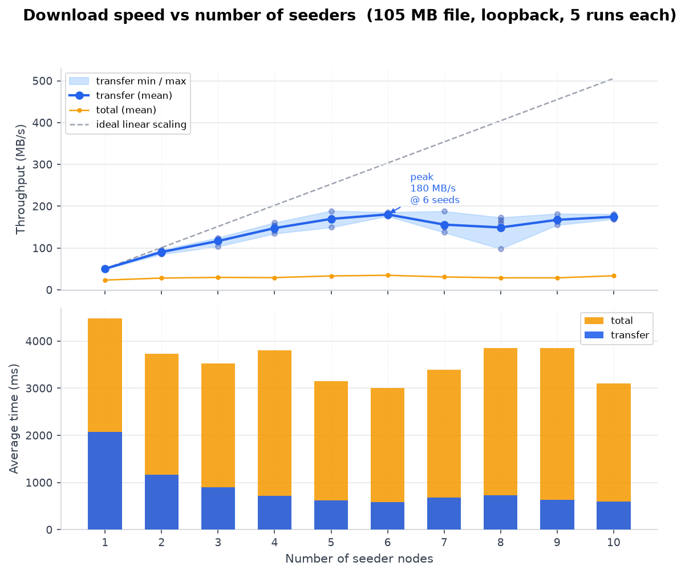
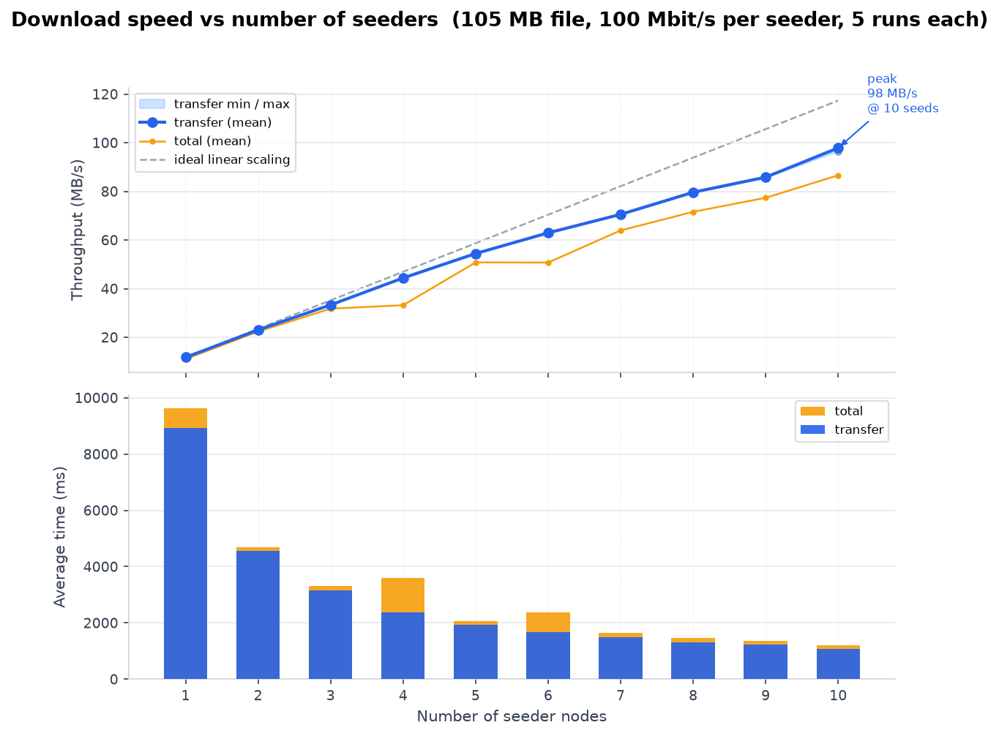

# Benchmarks

Two benchmarks measure how download speed changes with the number of seeders. A seeder is a peer that has the whole file.

- **Local:** all nodes in one JVM over loopback, with no network limit. Needs Java 21.
- **Network:** each node in its own Docker container, with each seeder's upload limited by `tc netem`. Needs Java 21 and Docker.

## Local benchmark

```bash
./gradlew benchmark --args="[maxSeeds] [iterations] [fileSize] [outputCsv]"
```

The defaults are 10 seeders, 3 runs each, a 100 MB file, and `benchmark/benchmark_results.csv`. Sizes can be given as `KB`, `MB` or `GB` (under 2 GB).

Results: [benchmark_results.csv](benchmark_results.csv)



## Network benchmark

```bash
benchmark/network/run.sh [maxSeeds] [iterations] [fileSize] [rate] [delay] [outputCsv]
```

The defaults are 10 seeders, 3 runs each, a 100 MB file, 100 Mbit/s and 20 ms delay per seeder, and `benchmark/network_results.csv`.

Results: [network_results.csv](network_results.csv)



## CSV columns

| Column | Meaning |
|---|---|
| `seeds` | Number of seeders |
| `iteration` | Run number for that seeder count |
| `file_size_bytes` | Size of the file |
| `transfer_ms` | Time to download all blocks |
| `total_ms` | Time for the whole download, including the hash check and saving the file |
| `transfer_mb_per_sec` | File size divided by `transfer_ms` |
| `total_mb_per_sec` | File size divided by `total_ms` |

A run that fails is written as `ERROR`.

## Drawing the graph

Needs Python with pandas and matplotlib.

```bash
python3 benchmark/build_graph.py [csv] [png] [setup]
```
